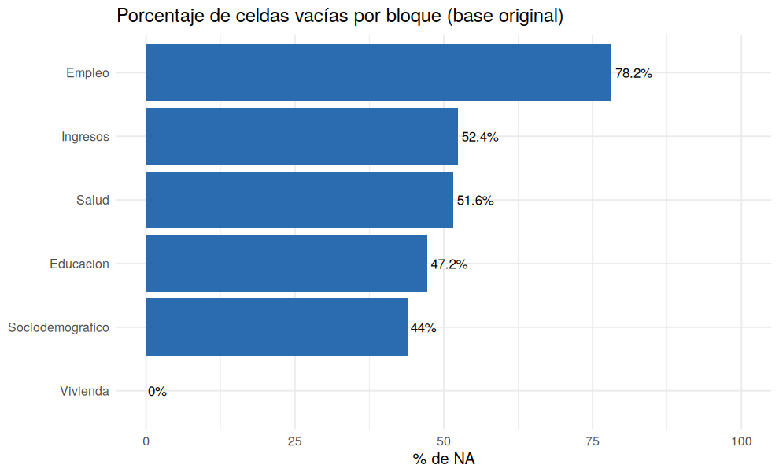

# 00 · Auditoría inicial de la base persona

## Resumen

La base tiene **39.497 filas y 275 columnas** (10.861.675 celdas). **6.261.409 celdas están vacías (57.6%)**. Este paso solo mide; no modifica nada.

## Contexto

Base de personas de la Encuesta de Hogares (INE Bolivia). Se perfila cada variable: tipo, NA, valores únicos, mínimo y máximo.

## Diagnóstico

- Columnas sin ningún NA: **46**
- Columnas con más de 90% de NA: **96**
- Columnas de valor único (unarias): **3**

| bloque | columnas | celdas_na | pct_na |
|---|---|---|---|
| Empleo | 111 | 3.429.948 | 78,2 |
| Ingresos | 41 | 848.869 | 52,4 |
| Salud | 44 | 896.083 | 51,6 |
| Educacion | 34 | 634.025 | 47,2 |
| Sociodemografico | 26 | 452.304 | 44,0 |
| Vivienda | 19 | 180 | 0,0 |

## Decisión y justificación

No se elimina ni imputa nada todavía. Un NA alto no implica dato perdido: muchas preguntas solo aplican a parte de la población (saltos de la boleta). Se estudia en los scripts 05 y 06.

## Procedimiento

`read_csv()` con `guess_max = Inf`, luego `colSums(is.na())`, `n_distinct()` y rangos por variable. Tabla completa en `data/metadatos/perfil_inicial.csv`.

## Resultados

## Validación

Se comprobó que ninguna columna está 100% vacía y que el número de filas coincide con el CSV (39.497).

## Puntos para exponer

- La base original está muy 'sucia' solo en apariencia: la mayoría de NA son estructurales.
- Empleo concentra el mayor % de NA porque sus preguntas aplican solo a ocupados.

## Archivos generados

- `scripts/00_auditoria_inicial.R`
- `images/00_na_por_bloque.png`
- `data/metadatos/perfil_inicial.csv`
- `data/interim/persona_00.rds`

