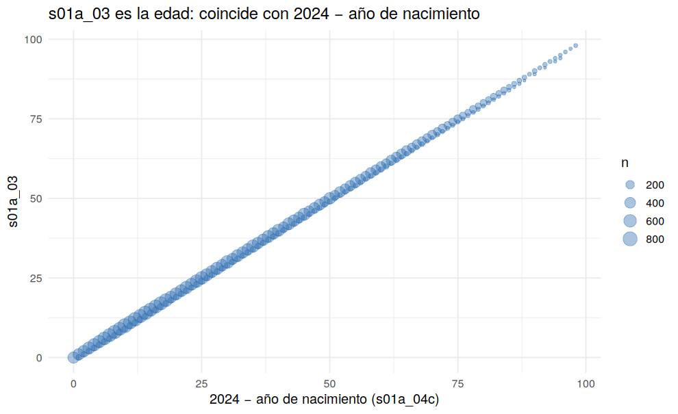

# 01 · Reconciliación del diccionario con los datos

## Resumen

El diccionario entregado **no coincide** con varias columnas. Se verificó con los datos y se creó `diccionario_corregido.csv`; además se añadieron los alias `sexo`, `edad` y `parentesco`.

## Contexto

Un diccionario desalineado lleva a limpiar mal (por ejemplo, tratar la edad como sexo). Por eso este es el primer paso.

## Diagnóstico

| variable | descripcion_diccionario | descripcion_real | evidencia | estado |
|---|---|---|---|---|
| s01a_02 | Parentesco con jefe/a | Sexo | Valores observados: 1,2 (2 categorías) | corregida |
| s01a_03 | Sexo | Edad en años | Rango 0-98; coincide con 2024 - año de nacimiento (±1) en 100.00% de filas | corregida |
| s01a_05 | Edad calculada | Parentesco con jefe/a del hogar | Valores observados: 1,2,3,4,5,6,7,8,9,10,11,12,13,14 | corregida |
| totper | Total de personas del hogar | Columna constante (=1); inutilizable | Valores: 1; NA: 20 | inconsistente |
| condact | 1=Ocupado, 2=Desocupado, 3=Inactivo | Códigos 1-5 (significado de 4 y 5 por confirmar) | Valores observados: 1,2,3,4,5 | inconsistente |
| tipohogar | 4 categorías | Más categorías que el diccionario | Valores observados: 1,2,3,4,5,6,7 | inconsistente |
| s01a_06 | Estado civil | Por verificar (muchos NA entre mayores de 12) | 83.6% NA entre personas de 12+ años; códigos hasta 25 | por_verificar |
| s01a_05a | Edad (meses) | Por verificar | Valores observados: 0,1,2,3,4,5,6,7,8,9,11,12 | por_verificar |

## Decisión y justificación

Se conservan las columnas originales y se agregan alias con el significado verificado. Las dudas (`s01a_06`, `s01a_05a`) quedan 'por verificar' contra la boleta oficial.

## Procedimiento

Se contrastó cada variable con sus valores observados y con la fecha de nacimiento (`2024 − s01a_04c`).

## Resultados

## Validación

La edad calculada coincide con `s01a_03` (±1) en el 100.00% de las filas.

## Puntos para exponer

- El diccionario tenía tres variables demográficas desplazadas.
- Se documentó cada corrección con evidencia reproducible.

## Archivos generados

- `scripts/01_diccionario_corregido.R`
- `images/01_edad_vs_nacimiento.png`
- `data/metadatos/diccionario_corregido.csv`
- `data/interim/persona_01.rds`

