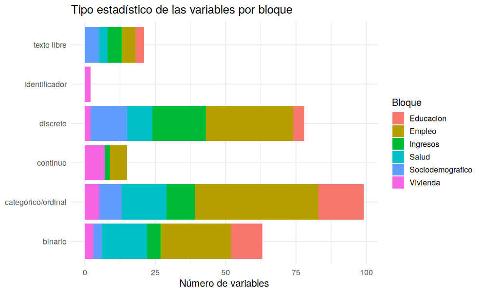

# 02 · Tipos de datos, columnas unarias y etiquetas

## Resumen

Se convirtieron **236 columnas** de decimal a entero (memoria 89 → 52 MB) y se detectaron **3 columnas unarias**.

## Contexto

`read_csv` lee como decimal cualquier columna con NA. Para códigos y conteos el tipo correcto es entero.

## Diagnóstico

Columnas unarias: `s02a_01e`, `s05c_09e`, `totper`

| tipo_estadistico | variables |
|---|---|
| binario | 63 |
| categorico/ordinal | 99 |
| continuo | 15 |
| discreto | 78 |
| identificador | 2 |
| texto libre | 21 |

## Decisión y justificación

Las unarias de tipo numérico (`totper`) no se borran todavía: se reconstruirán desde `folio`. Las de texto son respuestas 'especifique' y se conservan.

## Procedimiento

Se detecta si una columna decimal tiene solo valores enteros y se aplica `as.integer()`. El tipo estadístico se asigna por cardinalidad.

## Resultados

## Validación

Se verificó que el casting no alteró ningún valor (los NA siguen igual: mismo total antes y después).

## Puntos para exponer

- Clasificar variables (binario, categórico, discreto, continuo) define luego qué método de imputación usar.

## Archivos generados

- `scripts/02_tipos_unarias_etiquetas.R`
- `images/02_tipos_por_bloque.png`
- `data/metadatos/etiquetas_variables.csv`
- `data/interim/persona_02.rds`

