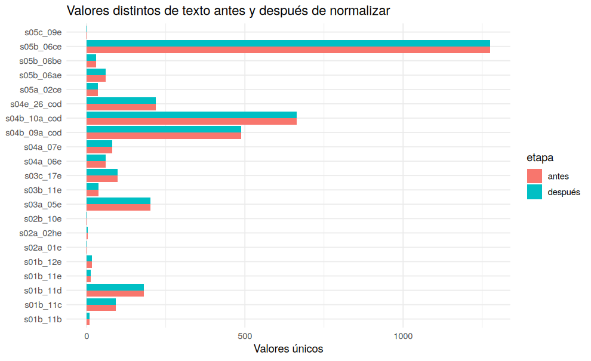

# 03 · Normalización de texto

## Resumen

Se normalizaron **23 columnas de texto**; se modificaron **0 celdas**.

## Contexto

Las columnas 'especifique' (`s03a_05e`, `s04a_06e`, etc.) contienen texto libre; los identificadores `folio` y `upm` también son texto.

## Diagnóstico

| variable | celdas_texto | celdas_cambiadas | unicos_antes | unicos_despues |
|---|---|---|---|---|
| folio | 39.497 | 0 | 12.718 | 12.718 |
| s01b_11b | 1.598 | 0 | 9 | 9 |
| s01b_11c | 1.598 | 0 | 93 | 93 |
| s01b_11d | 1.598 | 0 | 180 | 180 |
| s01b_11e | 150 | 0 | 12 | 12 |
| s01b_12e | 18 | 0 | 17 | 17 |
| s02a_01e | 2 | 0 | 1 | 1 |
| s02a_02he | 6 | 0 | 4 | 4 |
| s02b_10e | 2 | 0 | 2 | 2 |
| s03a_05e | 330 | 0 | 201 | 201 |
| s03b_11e | 37 | 0 | 37 | 37 |
| s03c_17e | 205 | 0 | 97 | 97 |
| s04a_06e | 65 | 0 | 60 | 60 |
| s04a_07e | 85 | 0 | 80 | 80 |
| s04b_09a_cod | 19.479 | 0 | 488 | 488 |
| s04b_10a_cod | 19.479 | 0 | 663 | 663 |
| s04e_26_cod | 1.357 | 0 | 218 | 218 |
| s05a_02ce | 36 | 0 | 35 | 35 |
| s05b_06ae | 144 | 0 | 60 | 60 |
| s05b_06be | 165 | 0 | 30 | 30 |
| s05b_06ce | 11.421 | 0 | 1.275 | 1.275 |
| s05c_09e | 7 | 0 | 1 | 1 |
| upm | 39.497 | 0 | 1.082 | 1.082 |

## Decisión y justificación

El texto ya venía en mayúsculas, sin tildes ni espacios sobrantes: el INE lo entregó normalizado. Se deja constancia y se mantiene el paso como control.

## Procedimiento

`stri_trans_general('Latin-ASCII')`, `str_squish()`, `toupper()` y conversión de cadenas vacías a NA.

## Resultados

## Validación

El total de NA solo puede aumentar si había cadenas vacías; se compara antes y después en el YAML.

## Puntos para exponer

- Un paso que no cambia nada también es un resultado: confirma que el texto ya estaba limpio.

## Archivos generados

- `scripts/03_normalizar_texto.R`
- `images/03_texto_antes_despues.png`
- `data/interim/persona_03.rds`

