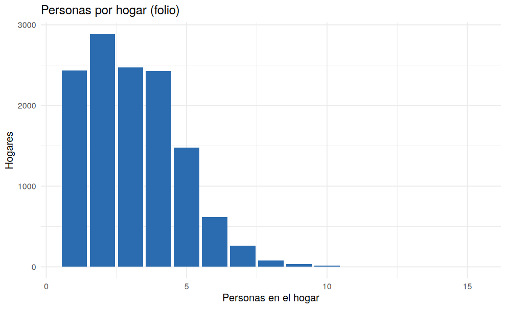

# 04 · Duplicados e integridad de llaves

## Resumen

Se eliminaron **0 filas** por duplicado. Se revisaron además la coherencia de llaves y la estructura de los **12.718 hogares**.

## Contexto

La llave de cada persona es `folio` + `nro`. Cada hogar debe tener un único jefe/a y compartir área y departamento.

## Diagnóstico

| control | resultado |
|---|---|
| Filas duplicadas exactas | 0 |
| Duplicados de llave (folio+nro) | 0 |
| Folios con formato inválido | 0 |
| Filas con upm incoherente con folio | 0 |
| Hogares (folios únicos) | 12.718 |
| Hogares con área inconsistente | 0 |
| Hogares con departamento inconsistente | 0 |
| Hogares sin jefe (parentesco=1) | 0 |
| Hogares con más de un jefe | 0 |
| Hogares con `nro` no consecutivo | 0 |

## Decisión y justificación

Solo se eliminaría un duplicado de llave o una fila idéntica. Las inconsistencias de estructura (hogares sin jefe o con varios) se **reportan** y se tratan en el Bloque 1.

## Procedimiento

`duplicated()` sobre la fila completa y sobre la llave; expresión regular para `folio`; agregación por `folio`.

## Resultados

## Validación

Tras el paso, `folio` + `nro` es llave única (0 duplicados).

## Puntos para exponer

- La base no tenía duplicados; la verificación de integridad prepara el recálculo de `totper`.

## Archivos generados

- `scripts/04_duplicados_integridad.R`
- `images/04_personas_por_hogar.png`
- `data/interim/persona_04.rds`

