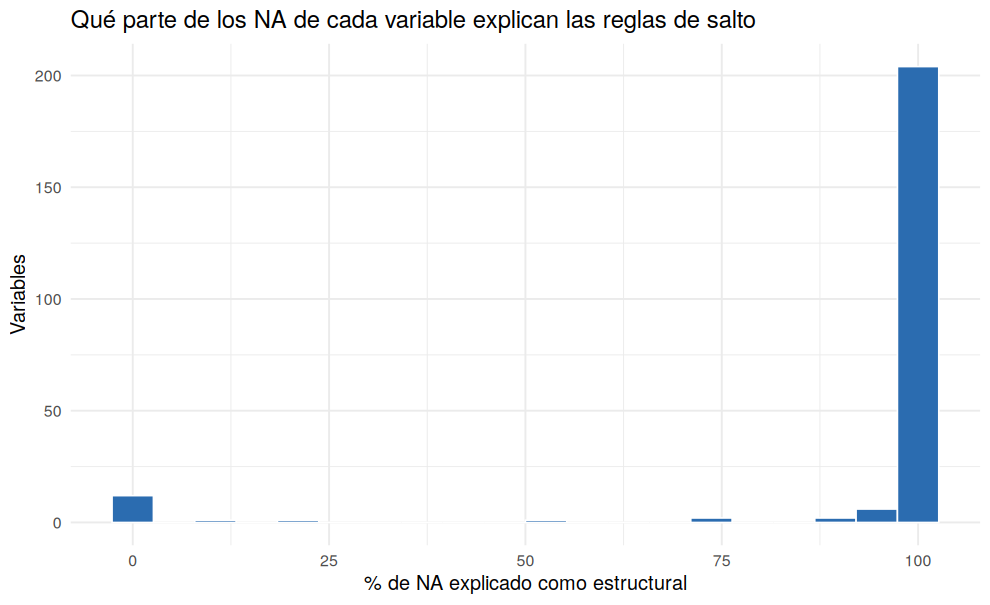

# 05 · Reglas de salto de la boleta (universo por variable)

## Resumen

Se dedujeron reglas de salto para **229 variables** con NA. Resultado: `data/metadatos/reglas_saltos.csv` y la máscara de NA estructurales.

## Contexto

No todos los NA son datos perdidos: la boleta solo hace ciertas preguntas a ciertas personas. Distinguirlos evita imputar valores sin sentido (por ejemplo, ingresos de un niño).

## Diagnóstico

Ejemplos de reglas halladas:

| variable | n_na | regla | na_estructural | na_real |
|---|---|---|---|---|
| s01a_06 | 30.897 | s03a_02a en {20 valores} Y s02b_06 en {NA} Y s03a_06a en {13,62,71,75,78,NA} | 23.086 | 7.811 |
| phrs | 20.018 | condact en {1} | 20.018 | 0 |
| totper | 20 | todos | 0 | 20 |
| ylab | 22.788 | s04b_12 en {1,2,3,4,5,7,8} | 22.640 | 148 |
| yhog | 20 | todos | 0 | 20 |
| cobersalud | 0 | todos | 0 | 0 |
| hnv_ult_a | 28.169 | sexo en {2} Y edad en [13,50] | 28.169 | 0 |
| niv_ed | 2.143 | edad en [4,98] | 2.143 | 0 |

## Decisión y justificación

Para cada variable se busca la condición más pequeña (edad, o una pregunta previa de la boleta) que cubra **todas** sus respuestas. Se descartan compuertas con la misma huella de NA (no son reglas, son copias) y grupos menores a 50 filas. Es una **estimación**: si un salto oculto no se detecta, el NA real queda sobrestimado.

## Procedimiento

Búsqueda voraz de hasta 3 compuertas por variable con `tabulate()` sobre variables discretas (≤ 25 valores) y rango de edad.

## Resultados

## Validación

Caso de control: `ylab` se contrasta contra la categoría ocupacional en el script 06.

## Puntos para exponer

- Las reglas se **descubren de los datos**, no se suponen.
- Esto cambia el objetivo: de 'eliminar NA' a 'separar NA estructurales de reales'.

## Archivos generados

- `scripts/05_reglas_de_salto.R`
- `images/05_na_explicado_por_reglas.png`
- `data/metadatos/reglas_saltos.csv`
- `data/interim/mascara_estructural.rds`
- `data/interim/persona_05.rds`

