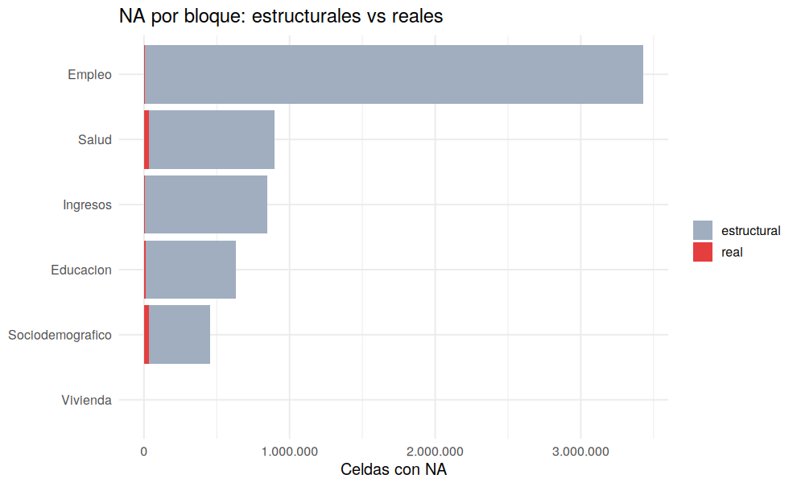

# 06 · Clasificación de NA: estructurales vs reales

## Resumen

De **6.261.409 NA**, **6.167.672 (98.5%) son estructurales** (la pregunta no aplicaba) y **93.737 son NA reales** candidatos a imputación.

## Contexto

Con las reglas del script 05 cada NA se asigna a una de dos clases. A cada variable con NA real se le sugiere una técnica del curso (moda, hot-deck, regresión, `mice`).

## Diagnóstico

| bloque | na_total | na_estructural | na_real | pct_estructural |
|---|---|---|---|---|
| Empleo | 3.429.948 | 3.425.789 | 4.159 | 99,9 |
| Salud | 896.083 | 860.828 | 35.255 | 96,1 |
| Ingresos | 848.869 | 840.768 | 8.101 | 99,0 |
| Educacion | 634.025 | 621.921 | 12.104 | 98,1 |
| Sociodemografico | 452.304 | 418.366 | 33.938 | 92,5 |
| Vivienda | 180 | 0 | 180 | 0,0 |

Variables con más NA reales:

| variable | bloque | na_real | pct_real_en_universo | estrategia_sugerida |
|---|---|---|---|---|
| s02a_05 | Salud | 27.595 | 87,6 | revisar: posible salto no detectado o MNAR |
| s01a_07_2 | Sociodemografico | 26.120 | 71,1 | revisar: posible salto no detectado o MNAR |
| s03c_17ab | Educacion | 12.078 | 45,3 | revisar: posible salto no detectado o MNAR |
| s01a_06 | Sociodemografico | 7.811 | 47,6 | revisar: posible salto no detectado o MNAR |
| s02b_10 | Salud | 3.626 | 57,2 | revisar: posible salto no detectado o MNAR |
| quienatenparto | Salud | 3.626 | 57,2 | revisar: posible salto no detectado o MNAR |
| s05a_04c | Ingresos | 3.080 | 10,3 | imputar con mice (PMM) |
| s05a_02a | Ingresos | 755 | 2,7 | imputar mediana / regresión |
| s05a_02b | Ingresos | 755 | 2,7 | imputar mediana / regresión |
| s05a_02c | Ingresos | 755 | 2,7 | imputar mediana / regresión |
| s05a_03a | Ingresos | 755 | 2,7 | imputar mediana / regresión |
| s05a_03b | Ingresos | 755 | 2,7 | imputar mediana / regresión |

## Decisión y justificación

Imputar solo NA reales. Las variables con más de 40% de NA real dentro de su universo se marcan 'revisar', porque suelen indicar un salto no detectado o un patrón MNAR.

## Procedimiento

Cruce de `reglas_saltos.csv` con el tipo estadístico (`etiquetas_variables.csv`) y reglas de decisión por % de NA real.

## Resultados

**Caso de control `ylab`** (ocupados por categoría ocupacional `s04b_12`):

| s04b_12 | ocupados | sin_ylab | pct_sin_ylab |
|---|---|---|---|
| 1 | 6.951 | 2 | 0,0 |
| 2 | 55 | 0 | 0,0 |
| 3 | 8.709 | 98 | 1,1 |
| 4 | 668 | 0 | 0,0 |
| 5 | 51 | 1 | 2,0 |
| 6 | 2.633 | 2.622 | 99,6 |
| 7 | 48 | 47 | 97,9 |
| 8 | 364 | 0 | 0,0 |

Regla hallada para `ylab`: `s04b_12 en {1,2,3,4,5,7,8}`.
Las categorías con casi 100% sin ingreso son coherentes con trabajo no remunerado (por confirmar en la boleta), por lo que gran parte de los NA de `ylab` entre ocupados son estructurales.

## Validación

Cada variable cumple n_na = na_estructural + na_real (se comprueba en el script 07).

## Puntos para exponer

- La gran mayoría de NA no es información perdida.
- Corrección sobre el diagnóstico inicial: no todos los ocupados sin `ylab` son faltantes reales; muchos son trabajadores sin remuneración.

## Archivos generados

- `scripts/06_clasificar_NA.R`
- `images/06_na_estructural_vs_real.png`
- `data/metadatos/na_clasificados.csv`
- `data/interim/persona_06.rds`

