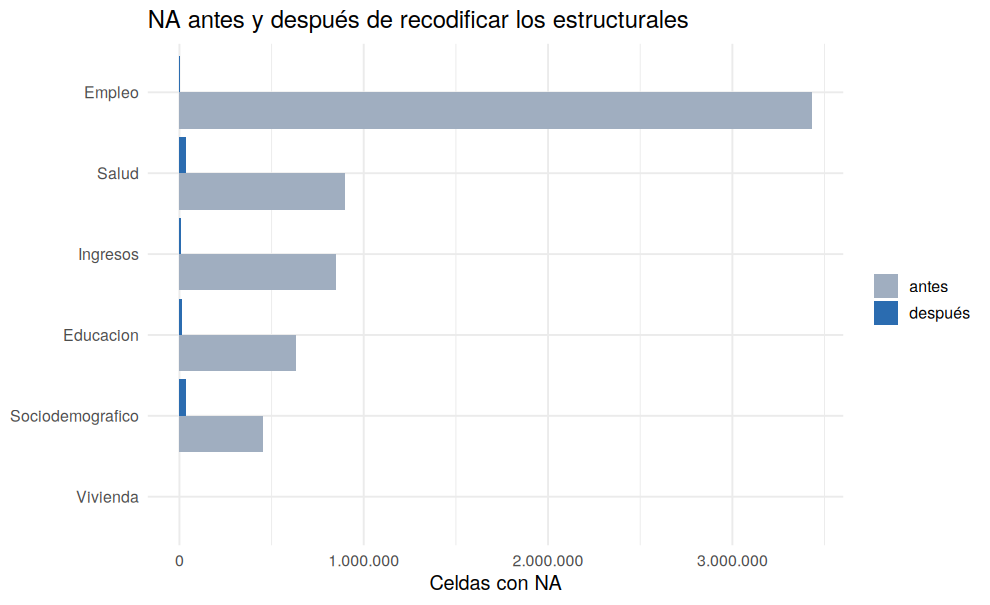

# 07 · Máscara de NA estructurales y recodificación

## Resumen

Los NA bajan de **6.261.409 a 93.737** (−98.5%). Lo que queda son los NA **reales**, que se imputarán en los Bloques 1 a 4.

## Contexto

Se mantienen dos versiones: la de análisis (con NA, más la máscara) y la codificada (cada NA estructural lleva un código explícito).

## Diagnóstico

| bloque | antes | despues |
|---|---|---|
| Educacion | 634.025 | 12.104 |
| Empleo | 3.429.948 | 4.159 |
| Ingresos | 848.869 | 8.101 |
| Salud | 896.083 | 35.255 |
| Sociodemografico | 452.304 | 33.938 |
| Vivienda | 180 | 180 |

## Decisión y justificación

Código `NO APLICA` en texto; `-1` en numéricas sin negativos; `-999` si ya existían negativos. En variables continuas (ingresos, horas) el código debe excluirse antes de calcular promedios; se marca en `codigos_no_aplica.csv`.

## Procedimiento

Para cada variable, `x[mascara] <- codigo`.

## Resultados

## Validación

Los NA que quedan equivalen a los NA reales estimados: 93.737.

## Puntos para exponer

- De la cifra inicial de NA solo queda una fracción pequeña: los NA reales.
- La versión codificada se guarda aparte; la de análisis conserva NA + máscara.

## Archivos generados

- `scripts/07_mascara_y_recodificacion.R`
- `images/07_na_antes_despues.png`
- `data/metadatos/codigos_no_aplica.csv`
- `data/interim/persona_07.rds` (con NA)
- `data/interim/persona_07_codificado.rds`

